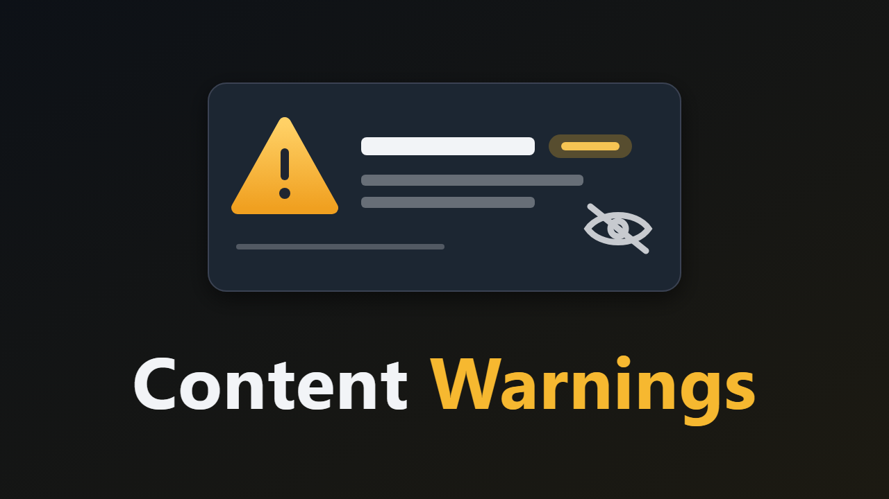

# Content Warnings – Jellyfin-Plugin (Jellyfin 12.x)



Zeigt auf Film- und Serienseiten die Inhaltswarnungen der Community von [DoesTheDogDie.com](https://www.doesthedogdie.com): stirbt ein Tier, gibt es Jump-Scares, Spinnen, Gewalt gegen Kinder, … Insgesamt über 200 Themen, von Nutzern abgestimmt.

- **Spoilerarm:** Eingeklappt steht nur „Inhaltswarnungen · 3 Themen“. Die Themen selbst erscheinen erst nach einem Klick.
- **Meine Themen:** Jeder Nutzer wählt seine persönlichen Themen. Sie werden hervorgehoben und schon im eingeklappten Zustand gezählt („2 deiner Themen“). Optional zeigt der Abschnitt nur diese Themen. Die Auswahl wird auf dem Server gespeichert und gilt auf allen Geräten.
- **Serien:** Auf Staffel- und Episodenseiten erscheinen die Warnungen der Serie.
- **Optional als Tags:** Ausgewählte Themen werden als Jellyfin-Tags geschrieben, z. B. `CW: a dog dies`. Damit lassen sich Titel über die Jugendschutz-Einstellung „Gesperrte Tags“ für einzelne Nutzer ausblenden, und auch native Apps können danach filtern.

## So kommen die Daten

Der Server fragt DoesTheDogDie, nicht der Browser. Der API-Schlüssel bleibt deshalb auf dem Server, und der Dienst erfährt nicht, wer was ansieht.

1. Beim ersten Aufruf einer Film- oder Serienseite sucht der Server den Titel über die IMDb-ID (ersatzweise TMDb) und holt die Abstimmungsergebnisse. Das sind 2 API-Abfragen.
2. Das Ergebnis landet im eigenen Zwischenspeicher des Plugins (`cache.json` im Datenordner des Plugins). Jellyfins Datenbank bleibt unberührt, außer bei den optionalen Tags.
3. Gespeichert werden die rohen Ja/Nein-Stimmen. Die Schwellen („mindestens 3 Ja-Stimmen und 60 % Ja“) lassen sich deshalb jederzeit ändern, ohne neu abzufragen.
4. Nach 60 Tagen werden Einträge aufgefrischt. Titel der letzten zwei Jahre werden viermal so oft aufgefrischt, weil sie noch Stimmen sammeln.
5. Die geplante Aufgabe **„Fetch content warnings“** (täglich 4:00) füllt den Zwischenspeicher vorab: zuerst Titel ohne Eintrag, dann die ältesten. Danach gleicht sie die Tags ab.

**Abfrage-Budget:** Der kostenlose API-Tarif erlaubt 30 Abfragen pro Minute und 5.000 pro Monat. Das Plugin bleibt bei 25 pro Minute und liest den Monatsrest aus jeder Antwort. Die geplante Aufgabe hört auf, sobald weniger als die eingestellte Reserve übrig ist (Standard 800). Die Reserve bleibt für Seitenaufrufe frei. Eine Bibliothek mit 2.000 Titeln ist so in etwa einem Monat vollständig erfasst.

Die API-Bedingungen verlangen, dass „Powered by DoesTheDogDie.com“ überall verlinkt ist, wo die Daten erscheinen. Das Plugin zeigt den Hinweis direkt unter dem Abschnitt. Der kostenlose Tarif ist nur für nicht-kommerzielle Nutzung.

## Einrichtung

1. Auf DoesTheDogDie.com ein Konto anlegen und im Profil unter „API“ einen kostenlosen Schlüssel erzeugen.
2. *Dashboard → Plugins → Content Warnings*: Schlüssel eintragen und **Save and test key** klicken.
3. Optional die Themen für Tags anhaken und die geplante Aufgabe einmal von Hand starten.

| Einstellung | Standard | Bedeutung |
|---|---|---|
| Show content warnings | an | Hauptschalter |
| Series, too | an | Auch Serien (und ihre Staffeln und Episoden) |
| Expanded by default | aus | Standard für alle; jeder Nutzer kann es für sich ändern |
| Minimum "yes" votes / share | 3 / 60 % | Ab wann ein Thema als zutreffend gilt |
| Refresh after (days) | 60 | Auffrischen des Zwischenspeichers |
| Scheduled task: titles per run | 300 | 0 = nur bei Seitenaufrufen nachschlagen |
| Monthly requests kept for page views | 800 | Reserve, die die Aufgabe nicht anrührt |
| Tag prefix / topics | `CW: ` / keine | Themen, die als Tags geschrieben werden |

## Installation

### Über das Plugin-Repository (mit Updates)

1. *Dashboard → Plugins → Repositorys → +* und diese URL eintragen:
   `https://raw.githubusercontent.com/skriewel/jellyfin-contentwarnings/main/manifest.json`
2. Im Katalog **Content Warnings** installieren, Jellyfin neu starten.

### Manuell

1. Ordner `dist\ContentWarnings_1.0.0.0` in das Plugin-Verzeichnis von Jellyfin kopieren.
2. Jellyfin neu starten, im Browser Strg+F5.

## Bauen

```powershell
.\build.ps1
```

## Neue Version veröffentlichen

1. Version in der `.csproj` und als Standardwert in `build.ps1` erhöhen, Changelog in `build.ps1` anpassen.
2. `.\build.ps1` ausführen: baut das Paket nach `dist\` und trägt die Version mit Prüfsumme in `manifest.json` ein.
3. Commit und Push, dann das GitHub-Release anlegen (Tag `v<Version>`, das ZIP aus `dist\` anhängen):
   `gh release create v<Version> dist\<Paket>.zip --title "<Name> <Version>"`
